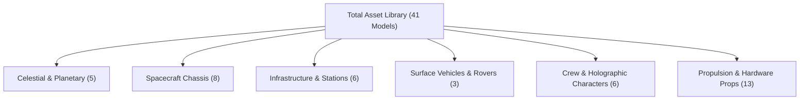

# Mission Architect — Asset Audit & Visual Polish Roadmap
**NASA Space Apps Challenge 2026 · Orbital Mechanics & Spacecraft Engineering Simulator**

---

## 1. Executive Summary & Current Asset Inventory

The project currently integrates **41 individual 3D glTF/GLB models** loaded dynamically via Three.js `GLTFLoader`. All 41 models have been audited, center/bottom-aligned, and verified at 60 FPS across all 9 game screens.

### Current 41-Model Breakdown
| Category | File Count | Assets Included | Current Role in Game |
| :--- | :---: | :--- | :--- |
| **Planets & Celestial** | 5 | `Planet_1`, `Planet_2`, `Planet_6`, `Planet_7`, `Planet_11` | Earth, Moon, Mars, Gas Giant, and Asteroid bodies |
| **Spacecraft Hulls** | 8 | `Spaceship_RaeTheRedPanda`, `Spaceship_FinnTheFrog`, `Spaceship_FernandoTheFlamingo`, `Spaceship_BarbaraTheBee`, `craft_speederA`, `craft_speederB`, `craft_cargoA`, `craft_miner` | Primary chassis in 3D Hangar and player-steered orbital craft |
| **Bases & Habitats** | 6 | `Base_Large`, `Building_L`, `GeodesicDome`, `House_Long`, `platform_large`, `hangar_largeA` | Surface delivery target bases and launchpad complex |
| **Planetary Rovers** | 3 | `Rover_1`, `Rover_2`, `rover` | Surface exploration targets in Mars & Moon operations |
| **Characters & Crew** | 6 | `Astronaut_RaeTheRedPanda`, `Astronaut_FernandoTheFlamingo`, `Astronaut_BarbaraTheBee`, `Astronaut_FinnTheFrog`, `astronautA`, `alien` | Lunar title mascot and holographic Commander briefing officer |
| **Rocket & Hardware** | 13 | `rocket_baseA`, `rocket_fuelA`, `rocket_sidesA`, `rocket_topA`, `satelliteDish`, `satelliteDish_detailed`, `machine_generator`, `machine_wireless`, `crater`, `craterLarge`, `meteor`, `meteor_detailed`, `rock_crystalsLargeA` | Launchpad multi-stage rocket stack, modular subsystems, and orbital debris |

---

## 2. What Is Currently Missing to Make the Game Look AAA/Indie Quality

While the 3D geometry and gameplay architecture are fully functional, the visual fidelity is currently constrained by procedural placeholders:

```mermaid
flowchart LR
    subgraph Current["Current State (Procedural)"]
        C1["Synthesized Web Audio Beeps"]
        C2["Procedural Dot Starfields"]
        C3["Flat Three.js Shading"]
        C4["Point-Mesh Particle Smoke"]
        C5["HTML/CSS Border UI"]
    end
    subgraph Target["Target Visual Polish"]
        T1["NASA Radio Comms & Rocket Rumbles"]
        T2["8K NASA Milky Way HDRI Skybox"]
        T3["PBR Textures (Albedo, Normal, Roughness)"]
        T4["Animated Plume Sprites & Lens Flares"]
        T5["NASA Vector Badges & Glassmorphism HUD"]
    end
    Current -->|Upgrade Path| Target
```

---

## 3. Recommended Asset Acquisition Plan (Prioritized by Impact)

### Priority 1: High-Resolution Celestial Texture Maps & Skyboxes
> [!IMPORTANT]
> The biggest visual leap for any space game comes from photorealistic planet surfaces and HDR space backgrounds.

* **Milky Way & Deep Space 360° Equirectangular HDRI (4K/8K)**:
  * Replaces the simple procedural star particles with deep space nebulae, realistic star clusters, and the galactic plane.
  * *Format*: `.hdr` or compressed `.jpg` (equirectangular projection `2:1`).
* **NASA Earth 4K/8K Texture Suite**:
  * Diffuse/Albedo texture (`earth_diffuse.jpg`).
  * Cloud coverage transparency map (`earth_clouds.png`).
  * Night-side city lights emission map (`earth_night_emission.png`).
  * Normal/Bump map for topographical elevation (`earth_normal.jpg`).
* **NASA Lunar Reconnaissance Orbiter (LRO) Moon Map**:
  * 4K color map with ray craters (Tycho, Copernicus) and dark basaltic maria (`lunar_diffuse.jpg`).
  * Bump/displacement map for rim shadows (`lunar_bump.jpg`).
* **USGS Mars Viking 4K Color Mosaic**:
  * High-fidelity rust-red Martian terrain with Valles Marineris and Olympus Mons (`mars_color.jpg`).
  * Martian cloud/ice cap overlays.

---

### Priority 2: Audio & Acoustic Atmosphere (Sound Design)
> [!TIP]
> Procedural beeps convey basic feedback, but authentic aerospace acoustics evoke emotional immersion.

* **NASA Mission Control Radio Comms (Public Domain)**:
  * Authentic Quindar telemetry beeps (2525 Hz intro / 2475 Hz outro tone).
  * Real Apollo 11 & Artemis I flight director audio loops:
    * *"Flight, we are go for launch."*
    * *"CapCom, trajectory is nominal."*
    * *"Telemetry confirmed, orbit achieved."*
* **Rocket Propulsion & Thruster SFX**:
  * Heavy low-frequency rocket engine ignition roar (sub-bass rumble, 30 Hz - 120 Hz).
  * Pneumatic RCS thruster pulses (crisp high-pressure gas hissing for pitch/yaw/roll maneuvers).
  * Spacecraft staging separation clamps (mechanical clank & explosive bolt pop).
* **Cinematic Space Ambient Soundtrack**:
  * 2 to 3 looped ambient synthesizer tracks (slow atmospheric pads, echoing piano notes, reminiscent of *Interstellar* / *The Martian*).
  * Smooth volume ducking during AI Commander voiceovers and critical launch sequences.

---

### Priority 3: Particle Atlases, Shaders & Visual FX
* **Rocket Plume Exhaust Sprite Atlas**:
  * Animated fire plume texture sheet (4x4 or 8x8 flame frames) for the chemical rocket and staging boosters.
  * Blue glowing ion thruster plasma halo texture.
* **Atmospheric & Reentry Particle Sparks**:
  * Glowing orange particle embers for launch booster separation and high-speed orbital capture.
* **Sun Optical Flare (Anamorphic Lens Flare)**:
  * Hexagonal lens flare artifacts when the camera pans toward the Sun.
* **Orbital Trajectory Ribbons**:
  * Three.js `Line2` glow shaders that trace Keplerian orbital ellipses in vibrant cyan/amber.

---

### Priority 4: Spacecraft Engineering Hardware Assets
* **Articulated Solar Panel Deployables**:
  * Circular ATK UltraFlex solar array models (Artemis Orion style) with metallic blue solar cell specular maps.
* **Scientific Sensor Payloads**:
  * High-resolution deployable magnetometers, LIDAR altimeters, and robotic sampling drills.
* **Docking Adapters & Staging Decouplers**:
  * Interstage structural trusses with wiring harnesses and umbilical clamps.

---

### Priority 5: UI & HUD Branding Assets
* **Vector NASA & Mission Patches (SVG / High-Res PNG)**:
  * Embroidered style mission emblem badges for:
    * Mission 01: Artemis Lunar Gateway Supply Patch.
    * Mission 02: Ares Mars Rover Expedition Patch.
    * Mission 03: Psyche Asteroid Sample Return Patch.
* **Flight Instrument Gauge Bezels**:
  * NavBall / Attitude Indicator vector textures for pitch, yaw, roll, and prograde/retrograde markers.
* **Holographic Scan Reticles**:
  * Sci-fi circular lock-on brackets for selecting planetary base stations and surface anomalies.

---

## 4. Free, Legally Verified Public Domain Sources

All recommended resources below are **100% royalty-free, public domain, or CC0** for hackathons and public web deployment:

| Asset Class | Recommended Source | License | Direct Link / Notes |
| :--- | :--- | :--- | :--- |
| **Planet Maps & Topography** | NASA Scientific Visualization Studio (SVS) | Public Domain | [NASA SVS Earth & Moon Textures](https://svs.gsfc.nasa.gov/) |
| **Planetary Maps (Mars/Moon)** | USGS Astrogeology Science Center | Public Domain | [USGS Astrogeology Planetary Maps](https://astrogeology.usgs.gov/) |
| **Deep Space HDRI Skyboxes** | Solar System Scope / NASA JPL | CC Attribution 4.0 / Public Domain | [Solar System Scope Textures](https://www.solarsystemscope.com/textures/) |
| **Radio Comms & Engine Audio** | NASA Audio Collection on Internet Archive | Public Domain | [NASA Audio Archive](https://archive.org/details/nasaaudio) |
| **Free Sci-Fi SFX & UI Audio** | Kenney Game Assets (Audio & UI) | CC0 (Public Domain) | [Kenney.nl Space Audio](https://kenney.nl/assets) |
| **High-Res Spacecraft 3D Models** | NASA 3D Resources | Public Domain | [NASA 3D Model Repository](https://nasa3d.arc.nasa.gov/models) |
| **Environmental HDRIs** | Poly Haven | CC0 | [Poly Haven Space/Night HDRIs](https://polyhaven.com/) |

---

## 5. Web Performance & Optimization Guidelines

To keep the game loading quickly on Vercel without large download times or GPU memory exhaustion:

1. **Draco / KTX2 Texture Compression**:
   * Run all `.glb` models through `gltf-pipeline` or `gltfpack` with `-c` flag (Draco geometry compression) to shrink file sizes by 60–80%.
2. **Texture Resolution Budget**:
   * Skybox HDRI: 4096×2048 (max 2 MB compressed WebP/JPG).
   * Planet Textures: 2048×1024 or 4096×2048 (max 1.5 MB each).
   * Subsystem Props: 1024×1024 shared texture atlases.
3. **Audio Streaming**:
   * Keep background ambient music in high-compression `.webm` / `.mp3` (96 kbps - 128 kbps), stream via HTML5 Audio element.
   * Keep short SFX (thruster bursts, Quindar beeps, clicks) as pre-decoded Web Audio API buffers (< 100 KB total).
